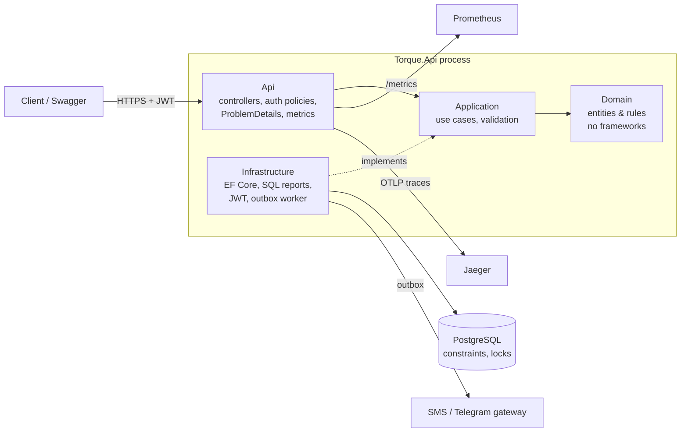
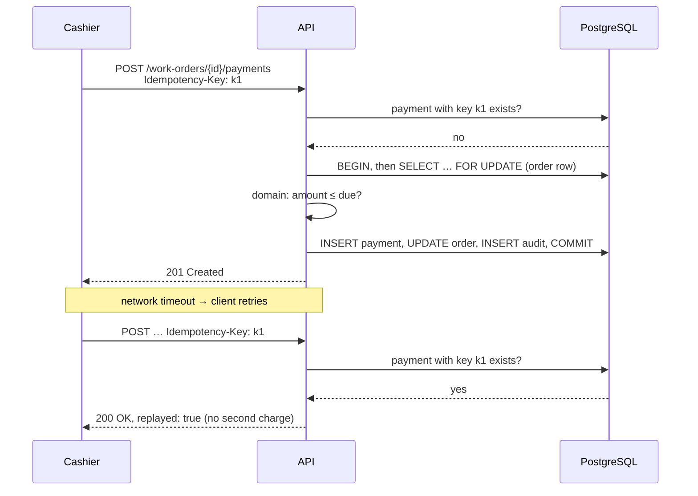

# Torque CRM

Backend API for a car service / tyre shop: staff accounts, customers and vehicles, booking service bays **without
double-booking**, work orders, payments that are **never charged twice**, reports, reminders and a full audit trail.

**.NET 10 · ASP.NET Core Web API · EF Core · PostgreSQL · JWT · Docker · xUnit + Testcontainers · OpenTelemetry · k6**

[](https://github.com/DEV3LISS/torque-crm/actions/workflows/ci.yml)
· 158 automated tests · 21 architecture decision records · measured performance · documented failure scenarios

## Why this project is interesting

The hard part of a booking CRM is not CRUD — it is staying correct when many people use it at once and things fail.

| Problem | Solution | Proof |
|---|---|---|
| Two managers book the same bay at the same second | PostgreSQL `EXCLUDE` constraint on `(bay, time range)` — the database guarantees no overlap | 10 simultaneous bookings → exactly 1 succeeds, 9 × 409 |
| A payment is retried after a network glitch | `Idempotency-Key` + unique index | 5 parallel retries → one payment |
| Two cashiers take the full amount at once | `SELECT … FOR UPDATE` on the order row | 5 parallel full payments → paid = total |
| Two people edit one work order | Optimistic concurrency on PostgreSQL `xmin` | totals always equal the sum of lines |
| A mechanic guesses another mechanic's order id (IDOR) | Ownership check in the use case | 403 |
| Reminder must survive crashes and go out once with 3 instances | Transactional outbox + `FOR UPDATE SKIP LOCKED` worker, back-off | 3 parallel workers → each message once |
| The database goes down | Liveness/readiness split, 503 + `Retry-After`, recovery without restart | chaos run in [failure-scenarios](docs/failure-scenarios.md) |
| "Who changed this price?" | Audit log via EF interceptor in the same transaction, personal data masked | audit tests |
| Search must stay fast on 100k customers | Normalised phones + trigram GIN index | k6: 190 → 1 944 req/s, p95 206 → 16 ms |

## Quick start

Requirements: Docker.

```bash
docker compose up --build
```

- Swagger UI: http://localhost:8080/swagger — log in with `admin@torque.local` / `ChangeMe-2026!` (demo seed; change via `.env`, see `.env.example`), then **Authorize** with the `accessToken`.
- Demo data (bays, services, customers) is created automatically.
- With metrics and traces: `docker compose --profile observability up --build` → Prometheus http://localhost:9090, Jaeger http://localhost:16686.

### Run from source

```bash
docker compose up -d db                       # PostgreSQL only
dotnet run --project src/Torque.Api           # Development settings, migrates + seeds automatically
dotnet test                                   # unit + architecture + integration (starts its own PostgreSQL)
TORQUE_E2E_URL=http://localhost:8080 dotnet test tests/Torque.E2ETests   # against a running stack
```

Create the first admin on a real deployment (there is deliberately no open "register admin" endpoint):

```bash
ADMIN_PASSWORD='a-long-passphrase' dotnet Torque.Api.dll create-admin --email owner@example.com --name "Owner"
```

## Architecture





Details: [requirements](docs/requirements.md) · [architecture](docs/architecture.md) · [database design](docs/database.md) ·
[decision records (21)](docs/decisions.md) · [performance](docs/performance.md) · [failure scenarios](docs/failure-scenarios.md) · [security (OWASP API Top 10)](docs/security.md)

## API

| Method | Route | Access |
|---|---|---|
| POST | `/api/v1/auth/login`, `/refresh`, `/logout` | anonymous (rate-limited) |
| GET | `/api/v1/users/me` | any staff |
| GET / POST / PUT | `/api/v1/users`, `/{id}`, `/{id}/role`, `/{id}/deactivate`, `/{id}/activate` | Admin |
| GET / POST / PUT | `/api/v1/customers` (search by any phone format or name part), `/{id}` (card), `/{id}/archive`, `/{id}/vehicles` | Admin, Manager |
| GET / PUT | `/api/v1/vehicles?plate=…` (Cyrillic or Latin), `/{id}` | Admin, Manager |
| GET / POST / PUT | `/api/v1/services`, `/api/v1/bays`, `/api/v1/working-hours` | read: staff · write: Admin |
| GET | `/api/v1/availability?date=…&serviceIds=…` | staff |
| GET / POST | `/api/v1/appointments` (board / book), `/{id}/reschedule`, `/cancel`, `/no-show`, `/check-in`, `/complete` | staff; booking: Admin, Manager |
| GET / POST | `/api/v1/work-orders`, `/{id}/lines/…`, `/discount`, `/start`, `/complete`, `/cancel` | staff (mechanics: own orders) |
| POST | `/api/v1/work-orders/{id}/payments`, `/refunds` (header `Idempotency-Key`) | Admin, Manager / Admin |
| GET | `/api/v1/reports/revenue`, `/top-services`, `/bay-utilization`, `/mechanics` | Admin |
| GET | `/api/v1/audit-logs` | Admin |
| GET | `/health/live`, `/health/ready` · `/health/status` (Admin) · `/metrics` | — |

All errors are [RFC 9457 Problem Details](https://www.rfc-editor.org/rfc/rfc9457) with a `correlationId` matching the server logs.

## Tests

| Project | What | Count |
|---|---|---|
| `Torque.UnitTests` | domain rules: phones, plates, VIN, calendar & time zones, slot finder, appointment lifecycle, work order money rules, outbox back-off; tokens; hashing | 78 |
| `Torque.IntegrationTests` | HTTP → real PostgreSQL (Testcontainers): auth & token theft, roles, IDOR, booking & **races**, payments & **races**, idempotency, audit, reports, reminders incl. outage, DB-down → 503, OWASP attacks, metrics | 76 |
| `Torque.ArchitectureTests` | layer dependency rules | 2 |
| `Torque.E2ETests` | full front-desk journey against the **deployed Docker image** | 2 |
| `loadtests/` | k6 load test + EXPLAIN ANALYZE scripts | — |

CI (GitHub Actions): build with warnings as errors → all tests → vulnerable-dependency check → E2E against `docker compose`.

## Engineering notes

- Clean layering enforced by tests; no repository-over-EF, no MediatR — see ADR-001…003 for the trade-offs.
- Money: `numeric(12,2)`, price snapshots, append-only payments, DB CHECK constraints as the last line of defence.
- Time: UTC everywhere, business time zone for opening hours and report grouping.
- 13 real bugs found during development (EF key generation, `xmin` with raw SQL, deadlocks under load, `LEAST` ignoring NULLs, …) are documented with cause and fix in the decision records.
