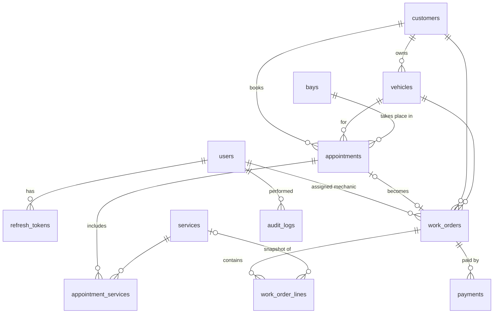

# Torque CRM — Database design

PostgreSQL 17. Naming: `snake_case` tables/columns (Npgsql naming convention), plural table names.

## 1. Review of the initial table list

Initial proposal: Users, Roles, Customers, Services, Appointments, Orders, OrderItems, Payments, AuditLogs.

| Table | Decision | Why |
|-------|----------|-----|
| Users | **Keep** | Staff accounts. |
| Roles | **Replace with enum column `users.role`** | Roles are fixed (Admin/Manager/Mechanic) and checked in code by policies. A table + join table adds two joins and admin screens for something that never changes. If custom roles/permissions are ever needed, migrate then. (ADR-004) |
| Customers | **Keep** | |
| — | **Add `vehicles`** | In a car service the job is done to a *car*, not a person. One customer has several cars; history ("what did we do last season") is per car. Without this table the CRM misses the core of the domain. |
| Services | **Keep** (catalog) | |
| — | **Add `bays`** | Double-booking is about a *bay* (physical place) at a time. Without bays there is nothing to check overlap against. |
| Appointments | **Keep** + exclusion constraint | The heart of the system. |
| — | **Add `appointment_services`** | An appointment books several services; total duration = sum. Many-to-many needs a join table. |
| Orders | **Keep, call it `work_orders`** | "Order" is ambiguous (purchase order? sales order?). Work order is the industry term. |
| OrderItems | **Keep as `work_order_lines`** with `kind` (Service / Part) and price snapshot | |
| Payments | **Keep** + `type` (Payment/Refund) + idempotency key | |
| AuditLogs | **Keep**, JSONB changes | |
| — | **Add `refresh_tokens`** | Needed for secure JWT refresh with rotation and revocation. |
| — | **Add `working_hours`** | Booking must respect opening hours per weekday. |
| — | **Add `outbox_messages`** (phase 2) | Reliable reminders. |

## 2. Diagram



## 3. Tables

Common columns on business tables: `id uuid` (UUIDv7, time-ordered → good index locality, safe to expose in URLs), `created_at timestamptz`, `updated_at timestamptz`.

### users
| column | type | notes |
|---|---|---|
| id | uuid PK | |
| email | varchar(254) UNIQUE | lower-cased in the domain before saving → a plain unique index gives case-insensitive uniqueness |
| full_name | text | |
| password_hash | text | |
| role | varchar(32) CHECK in ('Admin','Manager','Mechanic') | stored as text: readable in SQL, safe to reorder enum |
| is_active | bool | deactivate instead of delete |

### refresh_tokens
id, user_id FK, `token_hash` char(64) UNIQUE (SHA-256, never the raw token), `family_id`, created_at, expires_at, revoked_at, replaced_by_id; `xmin` as optimistic concurrency token (two parallel refreshes of one token cannot both succeed).
Indexes: unique(token_hash), (family_id), (user_id) WHERE revoked_at IS NULL.

### customers
| column | type | notes |
|---|---|---|
| id | uuid PK | |
| full_name | text | |
| phone | text UNIQUE | E.164, normalised in domain before saving |
| email | citext NULL | |
| notes | text NULL | |
| is_archived | bool | |

Indexes: unique(phone); trigram GIN index on `full_name` (`pg_trgm`) for "contains" search.

### vehicles
id, customer_id FK, make, model, year smallint NULL, `plate` text UNIQUE (normalised), vin text NULL UNIQUE.

### bays
id, name UNIQUE, is_active.

### working_hours
weekday smallint (1–7) PK, opens time, closes time, is_closed bool.

### services
id, name UNIQUE, category, `duration_minutes` int CHECK (> 0 AND % 15 = 0), `price numeric(12,2)` CHECK (>= 0), is_active.

### appointments
| column | type | notes |
|---|---|---|
| id | uuid PK | |
| customer_id | FK | |
| vehicle_id | FK | domain checks vehicle belongs to customer |
| bay_id | FK | |
| starts_at, ends_at | timestamptz | CHECK ends_at > starts_at |
| status | text | Scheduled, CheckedIn, Completed, Cancelled, NoShow |
| comment | text NULL | |

**The key constraint:**
```sql
CREATE EXTENSION IF NOT EXISTS btree_gist;

ALTER TABLE appointments ADD CONSTRAINT no_overlap_per_bay
  EXCLUDE USING gist (
    bay_id WITH =,
    tstzrange(starts_at, ends_at, '[)') WITH &&
  ) WHERE (status IN ('Scheduled', 'CheckedIn'));
```
Read: "no two rows with the same bay and overlapping `[start, end)` intervals, counting only active appointments". `[)` = end is exclusive, so 10:00–11:00 and 11:00–12:00 do not conflict. Cancelled appointments free the slot.

Why in the database: a C# check "is the slot free?" followed by an insert has a race window — two requests can both see "free" and both insert. The constraint makes the second insert fail atomically; the API maps the error (SQLSTATE `23P01`) to `409 Conflict`.

Indexes: the exclusion constraint's GiST index also serves "appointments of bay X on day Y"; plus (customer_id), (vehicle_id), (starts_at).

### appointment_services
appointment_id FK, service_id FK, PK(appointment_id, service_id).

### work_orders
| column | type | notes |
|---|---|---|
| id | uuid PK | |
| number | bigint UNIQUE (identity) | human-friendly "WO-1042" for receipts and phone talk |
| appointment_id | FK NULL UNIQUE | null for walk-ins; one appointment → at most one order |
| customer_id, vehicle_id | FK | |
| mechanic_id | FK users NULL | |
| status | text | Open, InProgress, Completed, Closed, Cancelled |
| discount_type, discount_value | text NULL, numeric(12,2) NULL | |
| subtotal, discount_amount, total | numeric(12,2) | computed in domain, stored for fast reports |
| completed_at, closed_at | timestamptz NULL | |
| xmin | system column | optimistic concurrency token (no extra column needed in PostgreSQL) |

Why store totals instead of always summing lines: reports over a year of orders would otherwise aggregate millions of lines; the domain keeps totals consistent because lines change only through the `WorkOrder` aggregate.

### work_order_lines
id, work_order_id FK (cascade delete), `kind` (Service/Part), service_id FK NULL, `name` text (snapshot), quantity numeric(10,2) CHECK > 0, unit_price numeric(12,2), line_total numeric(12,2).

Why snapshot name and price: if the catalog price rises next month, last month's order and receipt must not change.

### payments
| column | type | notes |
|---|---|---|
| id | uuid PK | |
| work_order_id | FK | |
| type | text | Payment, Refund |
| method | text | Cash, Card, Transfer |
| amount | numeric(12,2) CHECK > 0 | refund is a positive amount with type Refund — signs in data cause bugs |
| idempotency_key | text UNIQUE | from the `Idempotency-Key` header |
| received_by | FK users | |
| created_at | timestamptz | append-only: no update/delete |

"Payments cannot exceed amount due" is checked in the domain while the work order row is locked (`SELECT … FOR UPDATE`) — prevents two cashiers overpaying simultaneously.

### audit_logs
id bigint identity, `occurred_at`, user_id NULL (system jobs), `entity_type`, `entity_id`, `action` (Created/Updated/Deleted), `changes jsonb` (`{"status": {"old": "Open", "new": "InProgress"}}`), correlation_id.
Indexes: (entity_type, entity_id), (occurred_at DESC), (user_id).
Personal data policy: phone/email changes are logged masked.

### outbox_messages (phase 2)
id, type, payload jsonb, occurred_at, processed_at NULL, attempts, last_error. Partial index WHERE processed_at IS NULL.

## 4. Interview questions this schema answers

1. *How do you prevent double-booking?* — exclusion constraint, not just an app check; explain the race.
2. *Why UUIDv7 and not int or UUIDv4?* — non-guessable in URLs, generated in app before insert, time-ordered so B-tree inserts stay local (v4 fragments the index).
3. *Why `numeric` for money and not `float`/`double`?* — binary floating point cannot represent 0.1 exactly; money must be exact.
4. *Why price snapshot in order lines?*
5. *What happens when two managers edit the same order?* — `xmin` → `DbUpdateConcurrencyException` → 409.
6. *How do you avoid charging twice on a retry?* — idempotency key + unique index.
7. *Why no Roles table?*
